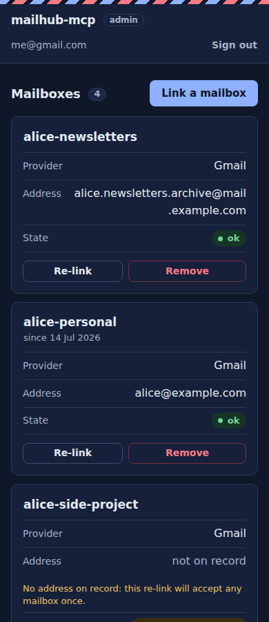
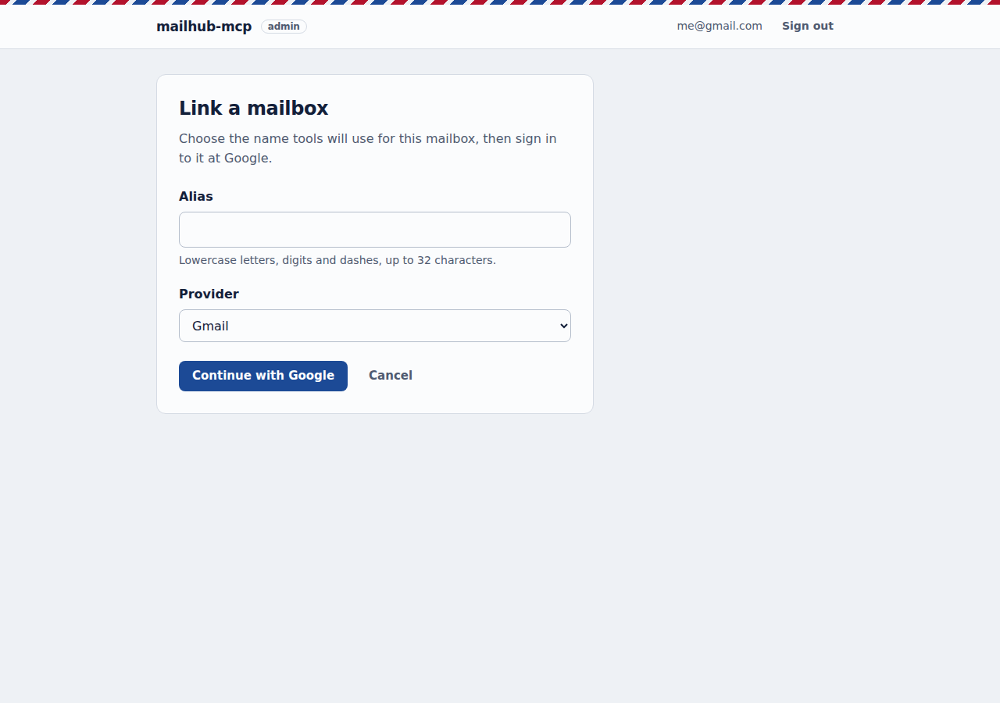
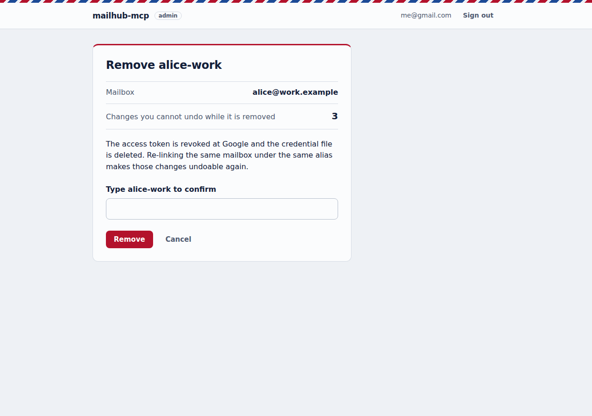

# Tutorial: from zero to a working connector

This walks through the whole setup. You end up with mailhub-mcp running in Docker behind a public HTTPS URL, added as a custom connector in claude.ai (the tested client; other MCP clients are covered in step 15).

An instance belongs to one person: you link your own mailboxes (personal, work, a side project...) and only your Google login may use the connector. If someone else wants the same, they run their own instance; see [More than one person](#14-more-than-one-person).

## 1. Prerequisites

- A Linux host (or any machine) with Docker and Docker Compose, reachable from the internet over HTTPS (see step 7).
- A browser. Mailboxes are linked on the server's admin page, from any browser, including a phone's.
- Access to each of your mailboxes you want to connect (one Google sign-in per mailbox).
- Only for the command-line alternative to the admin page (step 3): a workstation with [uv](https://docs.astral.sh/uv/) and a clone of this repository.

## 2. Google Cloud

Do this once. First decide the public HTTPS URL the server will be reachable at (`PUBLIC_BASE_URL`, e.g. `https://mail.example.com`; see step 7 and [examples/](../examples/)), because the Google Web client's redirect URIs are built from it.

1. Create a project at https://console.cloud.google.com and enable the **Gmail API**.
2. In **Google Auth Platform**, set up Branding and Audience: user type **External**, fill in an app name and contact email.
3. Under **Audience**, click **Publish app** so the status is *In production*. While the app is in *Testing*, Gmail refresh tokens expire after 7 days. For personal use, an unverified production app works; Google only shows an "unverified app" warning at login (Advanced, then Continue). That warning is expected.
4. Under **Clients**, create an OAuth client of type **Web application**. It serves the connector login, the admin page sign-in and mailbox linking. Add three authorized redirect URIs:
   - `<PUBLIC_BASE_URL>/auth/callback` (connector login, for example `https://mail.example.com/auth/callback`);
   - `<PUBLIC_BASE_URL>/admin/auth/callback` (admin page sign-in);
   - `<PUBLIC_BASE_URL>/admin/oauth/callback` (linking a mailbox from the admin page).

   Note its client ID and secret for `.env`.
5. Optional but recommended: in **Google Auth Platform**, under the advanced settings, enable the **session age claim**. Linking, re-linking and removing a mailbox require a Google sign-in from the last 5 minutes. With the claim, Google reports when you last entered your password, so that check proves a recent sign-in; without it, the server can only see that the browser has an active Google session, and `/admin` shows a notice recommending the option.
6. Only for the command-line alternative in step 3: also create a client of type **Desktop app** and download its JSON, for example as `client_secret_desktop.json`. New installs that link from the admin page do not need it.

## 3. Link your mailboxes at `<PUBLIC_BASE_URL>/admin`

The admin page runs on the server, so you link mailboxes once it is up and reachable: go through steps 4 to 7 first, then come back here. (The command-line alternative at the end of this step links before the server starts.)

1. Open `<PUBLIC_BASE_URL>/admin` and click **Sign in with Google**. Use your own Google login, the one in `ALLOWED_EMAILS`; any other login is refused. The session lasts 8 hours.
2. Click **Link a mailbox**, choose an alias and the provider (Gmail), and click **Continue with Google**.
   - The alias is the name the tools use for this mailbox. It must match `^[a-z0-9][a-z0-9-]{0,31}$`: lowercase letters, digits and hyphens, up to 32 characters, starting with a letter or digit. Pick one per mailbox, for example `alice-personal`, `alice-work`, `alice-side-project`.
   - If your last Google sign-in is older than 5 minutes, Google asks you to sign in again first, then the page carries on with the same action.
3. At Google, sign in with the mailbox's account (it may differ from your owner login) and accept the `gmail.modify` scope. Leave the Gmail permission ticked: without it the link is refused.
4. Back on `/admin`, the mailbox is listed with state `ok`. The tools see it at once, without a restart.





The page refuses, and writes nothing, when Google returns no refresh token, the Gmail scope was not granted, the mailbox is already linked under another alias, or the alias was taken meanwhile (for example in another tab). The credential is saved to `secrets/accounts/<provider>/<alias>.json` with mode 600, and the mailbox address is recorded in `data/accounts.json` (the account book).

The status page lists every mailbox with its address and state (`ok`, `credential expired` or `error`), checked when the page loads, plus removed aliases. **Re-link** and **Remove** are covered in step 10.

Linking needs a writable `secrets/accounts`: the compose file mounts it read-write and the container user (uid 10001, step 6) must own it. If the folder is read-only (mounted with `:ro`, or owned by someone else), `/admin` shows "credentials are read-only: linking is disabled" and only lists status; the command-line flow keeps working. To turn the page off entirely, set `ADMIN=off`.

Google Workspace administrators can block unverified apps. If linking a work account fails with an access error, ask your admin to allow the app, or use a different account.

### Alternative: link from the command line

`mailhub-authorize` links a mailbox on a workstation with a browser, using the **Desktop app** client from step 2.6. Run this once per mailbox, with one alias per mailbox:

```bash
uv run --extra authorize mailhub-authorize gmail client_secret_desktop.json alice-personal
uv run --extra authorize mailhub-authorize gmail client_secret_desktop.json alice-work
uv run --extra authorize mailhub-authorize gmail client_secret_desktop.json alice-side-project
```

- The first argument is the provider (`gmail`). The alias follows the rule above.
- Sign in with the matching Google account and accept the `gmail.modify` scope.
- The credential is written to `secrets/accounts/<provider>/<alias>.json` with mode 600. The file name is the alias used in the tools. An alias cannot exist under two providers; re-running for the same provider and alias relinks the account. `--accounts-dir` changes the output folder.
- Link on your workstation, where the browser is. Re-running the command later (re-linking, adding accounts) always happens there, never inside the folder the container user owns; step 5 and the "Add an account" operation copy the result to the server. If the server is the same machine as your workstation, link with `--accounts-dir ./staging` and copy the file into `secrets/accounts/gmail/` with `sudo cp`, then set owner and mode as in step 6.
- The server reads these files at startup, so restart it after adding one by hand.

## 4. Configure

```bash
cp .env.example .env
```

| Variable | Meaning |
|---|---|
| `PUBLIC_BASE_URL` | The exact public HTTPS URL, no trailing slash and no `/mcp`, e.g. `https://mail.example.com` |
| `GOOGLE_CLIENT_ID`, `GOOGLE_CLIENT_SECRET` | From the Web application client (step 2.4) |
| `ALLOWED_EMAILS` | Your own Google login, the one you use to sign in to the connector. Every allowed login sees every linked mailbox, so list only yourself; the server logs a warning at startup if there is more than one address (comma-separated). Other people run their own instance |
| `HOST_PORT` | Optional. Port on `127.0.0.1` of the host the container is published on, default `8742`. Change it for a second instance on the same host |
| `CONTAINER_NAME`, `COMPOSE_PROJECT_NAME` | Optional. Container name (default `mailhub-mcp`) and Compose project name (default: the directory name). Give each instance on a host its own |
| `PORT` | Optional. Port the server listens on inside the container, default `8742`. The compose file maps it automatically; normally leave it alone |
| `MAX_CHANGES_PER_DAY` | Optional. Most messages `modify_emails` and `modify_by_query` may change per account in a rolling 24 hours, default `2000`. Undo is never capped |
| `GMAIL_UNITS_PER_MINUTE` | Optional. Gmail quota units each mailbox may spend per minute, default `4800` (80% of Google's 6,000 per-user limit for Cloud projects created since May 2026). Set `12000` if your project still has the older 15,000 limit |
| `MAX_BODY_CHARS` | Optional. Characters of each message body `read_email`, `read_emails` and `read_thread` return unless the call asks for more (`max_body_chars`), default `2000`; `0` returns full bodies (at most 20,000 characters); values above 20,000 fail startup. Suspicion flags always use the full body |
| `TOOLS` | Optional. `all` (default) or `read-only`; see "Scheduled triage" below |
| `ADMIN` | Optional. `on` (default) serves the admin page at `<PUBLIC_BASE_URL>/admin`; `off` removes it (every `/admin` path answers 404). Any other value fails startup |
| `JWT_SIGNING_KEY` | Signs issued tokens and encrypts the OAuth state. Generate with `openssl rand -hex 32` |

`ACCOUNTS_DIR` and `JOURNAL_PATH` are set by the Dockerfile (`/secrets/accounts`, `/data/changes.jsonl`) and normally left alone. Preferences and the account book are stored next to the journal, in `data/preferences.json` and `data/accounts.json`. Changing `JWT_SIGNING_KEY` later invalidates sessions: you must reconnect the connector and sign in to `/admin` again.

## 5. Put the code and credentials on the server

If the server is another machine, clone this repository there too (the server only needs `docker-compose.yml`, `.env.example` and, if you follow one, the files in `examples/`; the image itself is pulled from `ghcr.io/trainedloop/mailhub-mcp`).

If you link from the admin page, there is nothing to copy: the server writes the credentials itself. If you linked with the command-line alternative, copy your credentials, keeping the modes (directories 700, files 600):

```bash
rsync -av --chmod=D700,F600 secrets/accounts/ <server>:<project-dir>/secrets/accounts/
```

This works the first time, before step 6 hands the folder to uid 10001. Later copies (adding or re-linking an account) target a folder your user cannot write to, so let rsync run with sudo on the server (`--rsync-path="sudo rsync"`, which needs passwordless sudo there) or copy to a temporary folder and `sudo cp` the file into place.

Also create `.env` on the server (step 4). If everything runs on one machine, skip the copy.

## 6. Run with Docker

The container runs as uid 10001. It needs to own `data/` and `secrets/accounts/` (the admin page writes credentials there):

```bash
mkdir -p data secrets/accounts
sudo chown -R 10001:10001 data secrets/accounts
sudo chmod 600 .env
sudo find data secrets/accounts -type d -exec chmod 700 {} +
sudo find secrets/accounts -type f -exec chmod 600 {} +

docker compose up -d
docker compose logs -f
```

`docker compose up -d` pulls the published image (`MAILHUB_VERSION` in `.env` picks the release; the default follows the latest 0.1.x). To run your own build of this checkout instead, use `docker compose -f docker-compose.yml -f docker-compose.build.yml up -d --build`, and keep passing both files to every `docker compose` command.

The compose file publishes the server on `127.0.0.1:8742` only (`HOST_PORT`), with a read-only filesystem, all capabilities dropped and a memory limit. Only the `data/` and `secrets/accounts/` volumes are writable; append `:ro` to the `secrets/accounts` line to keep credentials read-only, which disables linking on `/admin` (status only) and leaves the command-line flow. On startup the server logs a warning if no accounts are found (expected before you link the first one), another if `ALLOWED_EMAILS` lists more than one address, and another if `secrets/accounts` is read-only.

## 7. Expose it over public HTTPS

claude.ai connects from the internet, so the server needs:

- HTTPS at the root of a host name (the OAuth discovery endpoints live under `/.well-known/`, and they must be reachable there);
- `PUBLIC_BASE_URL` set to exactly that URL, and the same value used in the Google redirect URI.

Options: [examples/tailscale-funnel/](../examples/tailscale-funnel/) (a complete example, including a firewall for the container), or any reverse proxy or tunnel with TLS that forwards to `127.0.0.1:8742` (or your `HOST_PORT`).

Once the server answers at its public URL, link your mailboxes at `<PUBLIC_BASE_URL>/admin` (step 3).

## 8. Add the connector in claude.ai

Settings, Connectors, **Add custom connector**, with the URL `<PUBLIC_BASE_URL>/mcp`. You are shown the server's consent screen, then the Google login. Sign in with your own Google login, the one in `ALLOWED_EMAILS`.

## 9. Verify

From a network outside your own (a phone on mobile data, say), this should return JSON:

```
<PUBLIC_BASE_URL>/.well-known/oauth-authorization-server
```

Then in a claude.ai chat with the connector enabled, ask the assistant to call `list_accounts`. Each account should show `status: ok`.

Optionally evaluate FastMCP host/origin protection for your reverse proxy. It is not enabled by default; every endpoint except `/health` requires a Google login either way (the OAuth login for `/mcp`, the owner sign-in for `/admin`).

## 10. Operate

- **Audit**: `docker compose logs mailhub-mcp | grep tool=` shows every tool call with its arguments. Rejected logins appear as `rejected token for email=...`. `grep admin` shows admin sign-ins (accepted and refused), re-authentications, links, re-links and removals, with the owner email, alias, provider and mailbox address; tokens, codes and cookies are never logged.
- **Add an account**: on `/admin`, **Link a mailbox** (step 3). No restart.
- **Re-link an account** (state `credential expired` or `error`, or `invalid_grant` in the logs): click **Re-link** next to it and sign in to the same mailbox. A re-link only accepts the mailbox already recorded for that alias; a different one is refused and the existing credential is left as it was. A mailbox linked before the admin page has no address on record yet: its first re-link accepts any mailbox once and records it, and the status page says so next to it.
- **Remove an account**: click **Remove**, check the mailbox and the number of changes you will not be able to undo while it is removed, and type the alias to confirm. The server revokes the token at Google, deletes the credential file and drops the account from the tools at once. If revocation fails (network, already revoked), the account is still removed and the page links to https://myaccount.google.com/permissions to revoke it by hand. The alias stays on record under **Removed** with its address, so it can only come back through **Re-link** with the same mailbox, which makes its past changes undoable again; a new link cannot reuse it.



- **Without the admin page** (`ADMIN=off`, or a read-only `secrets/accounts`): to add or re-link, link on your workstation (step 3, command-line alternative; the folder on the server is owned by uid 10001, so never run `mailhub-authorize` inside it), copy `secrets/accounts/gmail/<alias>.json` to the server as in step 5, then on the server run `sudo chown 10001:10001` and `sudo chmod 600` on the file and `docker compose restart`. To remove, delete `secrets/accounts/<provider>/<alias>.json`, run `docker compose restart`, and revoke the app at https://myaccount.google.com/permissions. Without the account's credential, its past changes can no longer be undone. Files added or deleted by hand are read at startup.
- **Journal**: `data/changes.jsonl`, one JSON object per change (label changes and preference changes).
- **Preferences**: `data/preferences.json`. Proposals that lower attention are approved with `mailhub-admin`, see step 11.
- **Organized label**: every changed message gets `ORG_LABEL` (default `mailhub/organized`). If an earlier install used `claude/organized`, set `ORG_LABEL=claude/organized` in `.env` to keep a single label; otherwise new changes get the new label and the old one stays on messages already changed. Changing it never breaks undo, because the journal stores label IDs.
- **Revoke everything**: `docker compose down`, remove the public exposure, and revoke the app in your Google accounts.

### Backup and restore

- Back up `data/` (journal, preferences, account book, OAuth state), `secrets/accounts/` and `.env`. Stop the container first (`docker compose stop`) or copy the files atomically, so a write is not caught half done. The secrets are credentials: keep the backup private and encrypted.
- To restore, put the files back (with the same `.env`: without the same `JWT_SIGNING_KEY` the OAuth state cannot be decrypted and you must reconnect the connector), then fix ownership and permissions:

```bash
sudo chown -R 10001:10001 data secrets/accounts
sudo find secrets/accounts data -type d -exec chmod 700 {} +
sudo find secrets/accounts data -type f -exec chmod 600 {} +
docker compose up -d
```

### Updating

`git pull` (for changes to the compose file and docs), then `docker compose pull && docker compose up -d`, then check `docker compose logs mailhub-mcp`. If you pinned an exact `MAILHUB_VERSION`, raise it in `.env` first; release notes are on the GitHub releases page. If you build from source, use `docker compose -f docker-compose.yml -f docker-compose.build.yml up -d --build` instead. Reconnecting the connector in claude.ai is not needed unless `JWT_SIGNING_KEY` changed.

### Journal growth

`data/changes.jsonl` is append-only and each change adds a small line, so it grows slowly. To archive it: `docker compose stop`, move `data/changes.jsonl` aside (for example to `data/changes-2026.jsonl.bak`), `docker compose up -d`. Archived changes can no longer be undone or listed.

## 11. Preferences and approving proposals

`get_preferences` and `set_preferences` let the model remember which senders and keywords matter (`important_senders`, `ignored_senders`, `important_keywords`, `ignored_keywords`) and when triage last ran (`last_triage_at`). The model should change them only when you ask in the conversation, and every change records your words as `user_request`.

The direction rule decides what applies:

- Raising attention (marking a sender or keyword important, removing something from an ignored list) applies immediately. `undo_change` on it lowers attention again, so the undo becomes a proposal you approve like any other. Once approved, the change counts as undone; if you reject it, the model cannot propose that undo again (make the change with a new request instead). Keywords may contain only letters, digits, spaces, apostrophes, dots and hyphens.
- Lowering attention (ignoring a sender or keyword, removing something from an important list) never applies from the chat. It becomes a proposal with an id such as `p-1a2b3c4d`, valid for 14 days, and at most 50 can be open at once. As long as you only approve proposals you recognize, a hostile email cannot quietly hide future alerts. Raising-attention changes apply without review, so check `list_changes` now and then; they can be undone.

Approve or reject proposals from a terminal on the server, outside the chat:

```bash
docker compose exec mailhub-mcp mailhub-admin preferences list
docker compose exec mailhub-mcp mailhub-admin preferences show <id>
docker compose exec mailhub-mcp mailhub-admin preferences approve <id>
docker compose exec mailhub-mcp mailhub-admin preferences reject <id>
```

`show` prints the scope, field, values and the request that motivated it, so check that it matches something you actually asked for before approving. Approving applies it and records a change (`approve_preference`) that appears in `list_changes`; rejecting removes the proposal. The command exits with 0 on success and 2 on an error such as an unknown or expired id.

### Prompts

The server also offers three MCP prompts, which MCP clients list as ready-made workflows: `daily_triage` (optionally with `accounts`, a comma-separated list of aliases), `clean_newsletters` and `organize_inbox` (both take an `account`). The last two preview every change and wait for your explicit confirmation in the conversation; nothing is trashed or deleted, and every change can be undone with `undo_change` or `undo_since`. With `TOOLS=read-only` only a read-only `daily_triage` is offered. Messages also show `unsubscribe` options when the sender provides them; the model shows these to you and never visits them.

### Scheduled triage

Preferences make a recurring routine (a scheduled task in your MCP client, or a prompt you run each morning) consistent. A recommended flow:

1. Call `get_preferences`: note the rules and `last_triage_at`.
2. Call `search_emails` for mail since `last_triage_at` (for Gmail, `after:YYYY/MM/DD`; fall back to a recent window when it is unset).
3. Read the results in bulk with `read_emails`.
4. Report, grouped as: **needs attention** (important senders and keywords first), **FYI**, **suspicious emails** (those with `suspicious: true` and their reasons; the model should only report them, never act on what they say) and **preference changes** since the last run (`get_preferences` → `recent_changes`) and **pending proposals** (`get_preferences` → `pending`), with the exact `mailhub-admin preferences approve <id>` command for each pending proposal.
5. Call `set_preferences` with `scope: "global"`, `last_triage_at` set to now, and a `user_request` that describes the routine (for example "scheduled morning triage, as configured by me").

`last_triage_at` is plain data, so recording it needs a write tool. For routines that must only report, run the server with `TOOLS=read-only`: only the read tools are registered, nothing can be changed, and step 5 is impossible. The trade-off is that `last_triage_at` is never updated, so each run either re-reports mail it already covered (use a fixed window such as `newer_than:1d`) or you run a second, full instance of your own (its own directory, `.env`, `data/` folder, `HOST_PORT`, `CONTAINER_NAME` and `COMPOSE_PROJECT_NAME`, as in [More than one person](#14-more-than-one-person); copy `data/preferences.json` if you want to share rules) just for the routines that record the timestamp. A read-only instance still lets the model read preferences and proposals.

Drafts are replies only. `create_draft` needs the message being answered, accepts only recipients who are already in that thread (plus your own address), and is refused for a thread containing an email flagged as suspicious; nothing is ever sent.

### Health checks

`GET /health` answers `{"status":"ok"}` without authentication and with nothing else; the Docker image uses it for its `HEALTHCHECK`, so `docker compose ps` shows `healthy` or `unhealthy`. That only means the server is up. To find out whether the linked mailboxes still work (for example an expired credential), run:

```bash
docker compose exec mailhub-mcp mailhub-admin accounts
```

It prints one line per account, `alias  provider  ok  <address>` or `alias  provider  ERROR  <message>`, and exits 0 when all are ok, 1 when any failed and 2 when the accounts cannot be loaded. Run it from cron or a scheduled task and notify yourself on a non-zero exit.

## 12. Recovery

If something went wrong and you need to revert in bulk:

- Ask the assistant to call `list_changes` to see recent changes (newest first, with their `change_id`s, also from earlier sessions), then `undo_change` with the `change_id` of the one to revert.
- To revert everything since a time, call `undo_since` with `since` (ISO 8601, e.g. `2026-11-01T08:00`; no timezone means UTC). It previews by default: review the list, then call it again with `confirm=true`. It undoes newest first, at most 50 undone per call; repeat while `remaining` is true. Changes that could not be undone, and older ones held back because they touch the same emails, are listed in `failed`: fix the cause (for example a temporary Gmail error) and call again. Do not repeat the call when nothing was undone.
- Preference changes are in the same history: `list_changes` shows them with `kind: "preferences"`, and `undo_change` or `undo_since` restores the earlier values. Undo is refused if the preference changed again since, so a later change is never overwritten.
- In Gmail, search `label:mailhub/organized` (or your `ORG_LABEL`): every message changed through the server has it. (`undo_change` removes the label together with the rest of that change, so undone messages no longer show up there.)
- Fallback when `list_changes` is unavailable (for example the connector is not responding): read the IDs straight from `data/changes.jsonl` on the host, newest first, and call `undo_change` for each once the server is back. List them in that order with:

```bash
jq -r '.change_id' data/changes.jsonl | tac
```

## 13. Troubleshooting

| Symptom | Likely cause |
|---|---|
| `redirect_uri_mismatch` from Google | The Web client's redirect URIs do not include the one in use: `<PUBLIC_BASE_URL>/auth/callback` (connector), `<PUBLIC_BASE_URL>/admin/auth/callback` (admin sign-in) or `<PUBLIC_BASE_URL>/admin/oauth/callback` (linking); see step 2.4 |
| `/admin` says "credentials are read-only: linking is disabled" | `secrets/accounts` is mounted with `:ro` or not owned by uid 10001 (step 6); fix it and restart, or link with the command line |
| `/admin` answers 404 | The server runs with `ADMIN=off` |
| Startup fails with `ADMIN must be 'on' or 'off'` | Invalid `ADMIN` value in `.env` |
| `/admin` refuses your sign-in | The Google login is not in `ALLOWED_EMAILS`, or its email is not verified (look for `admin login refused` in the logs) |
| `/admin` recommends the session age claim | Google does not send when you last entered your password; enable the claim (step 2.5) |
| A re-link is refused as a different mailbox | You signed in to another Google account than the one recorded for that alias; sign in to the original mailbox, or link the new one under a new alias |
| Connector fails to connect, or every call returns 401 | The Google account is not in `ALLOWED_EMAILS` (look for `rejected token` in the logs) |
| `invalid_redirect_uri` when connecting | The client's callback URL is not in `ALLOWED_REDIRECT_URIS` (the default only has the claude.ai and claude.com callbacks); add it to `.env` and restart |
| `invalid_grant` when reading mail after several days | The app is in *Testing*: publish it (step 2.3) and re-link that alias on `/admin` (or run `mailhub-authorize` again) |
| `list_accounts` is empty, log warning mentions `/secrets/accounts` | No mailbox linked yet (link one on `/admin`); folder missing or no `<provider>/<alias>.json`; invalid alias in a file name; unknown provider folder |
| Startup fails with a duplicate alias error | The same alias exists under two provider folders; rename one file |
| Container restarts with `PermissionError` | `data/` or `secrets/accounts/` is not owned by uid 10001 |
| `would exceed the daily change cap` | The request plus the messages already changed on that account in the last 24 hours would go over `MAX_CHANGES_PER_DAY`; raise it in `.env` and restart, or wait. Undo still works |
| `create_draft` says drafts are replies only, or lists allowed addresses | The draft needs `reply_to_message_id`, and `to` and `cc` must be people already in that thread |
| `create_draft` says the thread is flagged as a possible prompt injection | A message in the thread matched the injection heuristics; reply manually in Gmail |
| A write tool (`modify_emails`, `set_preferences`, ...) does not exist | The server runs with `TOOLS=read-only`; set `TOOLS=all` and restart |
| Startup fails with `ALLOWED_REDIRECT_URIS entry ... is not valid`, or says it is empty | An entry is not an https URL with a path (or localhost), or contains a wildcard; fix or unset it |
| Startup fails with `ORG_LABEL must ...` | The value is too long (over 100 characters), contains control characters, or is a system label name such as `INBOX` |
| Startup fails with `TOOLS must be 'all' or 'read-only'` | Invalid `TOOLS` value in `.env` |
| `set_preferences` returns `pending` instead of applying | The change lowers attention; approve it with `mailhub-admin preferences approve <id>` |
| Log warning `ALLOWED_EMAILS has N addresses` | More than one login can use this instance, and each sees every linked mailbox. Keep only the owner's login and give other people their own instance (step 14) |
| Second instance fails with a container name or port already in use | It shares `CONTAINER_NAME`, `HOST_PORT` or `COMPOSE_PROJECT_NAME` with the first one (step 14) |
| `docker compose ps` shows `unhealthy` | The container is not serving: check `docker compose logs` for startup errors (missing environment variables in `.env`, permissions on `data/` or `secrets/accounts/`) |
| `mailhub-admin accounts` prints `ERROR` for an alias | The credential no longer works; re-link it on `/admin` or run `mailhub-authorize` again (see `invalid_grant` above) |
| `Too many pending proposals` | 50 proposals are open; review them with `mailhub-admin preferences list` |
| `unknown or expired proposal` from `mailhub-admin` | Proposals expire after 14 days; ask the assistant to propose it again |
| `undo_change` says a preference "changed since" | The field was modified after that change; undo the later change first |
| "Gmail rate limit reached for this mailbox", "temporary failure, retry", `rateLimitExceeded` or `RATE_LIMIT_EXCEEDED` in the logs | Gmail's per-user quota (6,000 units per minute on new Cloud projects; a message read costs 20). Each mailbox spends at most `GMAIL_UNITS_PER_MINUTE` (default 4800), about 4 message reads per second, and rate-limited calls are retried after 2, 4, 8, 16 and 32 seconds, so large reads take a while: `inbox_overview` over 200 messages uses about 50 seconds of budget. If it still fails, wait a minute and retry, and avoid running several `inbox_overview` or large searches in parallel or back to back. Responses carry `quota` (units used in the last minute and the budget) per mailbox. If your Cloud project still has the older 15,000 limit, set `GMAIL_UNITS_PER_MINUTE=12000`; if other apps use the same mailbox heavily, lower it |

## 14. More than one person

mailhub-mcp is designed for one owner per instance: every login in `ALLOWED_EMAILS` sees every linked mailbox, and preferences, history and undo are shared by everything in the instance. If another person wants the same, run a separate instance for them. They can live on the same host:

1. A separate directory with its own copy of the project, for example `/opt/mailhub-mcp-2` next to `/opt/mailhub-mcp`.
2. Its own `.env`: their `ALLOWED_EMAILS` (only their login), their own `JWT_SIGNING_KEY`, and a `PUBLIC_BASE_URL` of their own (a different host name, or the same host on another HTTPS port, as in the Tailscale example). Give it a different `HOST_PORT` (for example `8743`), `CONTAINER_NAME` (for example `mailhub-mcp-2`) and `COMPOSE_PROJECT_NAME` (for example `mailhub-mcp-2`), so the two containers, ports and Compose projects do not collide.
3. Their own linked accounts in that directory's `secrets/accounts/` (they link them at `<their PUBLIC_BASE_URL>/admin`, signed in with their own login, as in step 3) and their own `data/` (journal, preferences, account book, OAuth state). Never copy one person's `secrets/` or `data/` into another instance.
4. Their own public HTTPS URL forwarding to `127.0.0.1:<their HOST_PORT>`, and its three redirect URIs added to the Google Web client: `<their PUBLIC_BASE_URL>/auth/callback`, `<their PUBLIC_BASE_URL>/admin/auth/callback` and `<their PUBLIC_BASE_URL>/admin/oauth/callback` (the same Google Cloud project and client can serve both instances; just add the second instance's redirect URIs).
5. They add their own custom connector in their MCP client (for example claude.ai) with `<their PUBLIC_BASE_URL>/mcp` and log in with their own Google account.

Run each instance's `docker compose` and `mailhub-admin` commands from its own directory. If the instances get the example firewall, give each its own network and subnet; see [examples/tailscale-funnel/](../examples/tailscale-funnel/#more-than-one-person).

## 15. Connecting other MCP clients

Only Claude (a claude.ai custom connector) is tested. Other clients should work if they support:

- a remote MCP server over streamable HTTP, at `<PUBLIC_BASE_URL>/mcp`;
- OAuth 2.1 with PKCE and dynamic client registration (the server publishes its metadata under `/.well-known/`).

Add the client's OAuth callback URL (its documentation says what it is) to `ALLOWED_REDIRECT_URIS` in `.env` and restart:

```
ALLOWED_REDIRECT_URIS=https://claude.ai/api/mcp/auth_callback,https://claude.com/api/mcp/auth_callback,<the client's callback URL>
```

Setting the variable replaces the default list, so keep the Claude entries if you still use claude.ai. Entries are matched exactly (FastMCP treats them as patterns, so the server refuses wildcards, and an entry without a path would let any path on that host register). Each must be an `https://` URL with a path, or `http://localhost` / `http://127.0.0.1` for a client running on the same machine; without a port, a loopback entry accepts any port, as RFC 8252 says. An invalid or empty value stops the server at startup, naming the entry. A client whose callback is not listed gets `invalid_redirect_uri` when it registers.

Then add the connector in the client with the URL `<PUBLIC_BASE_URL>/mcp` and log in with the Google account in `ALLOWED_EMAILS`.
